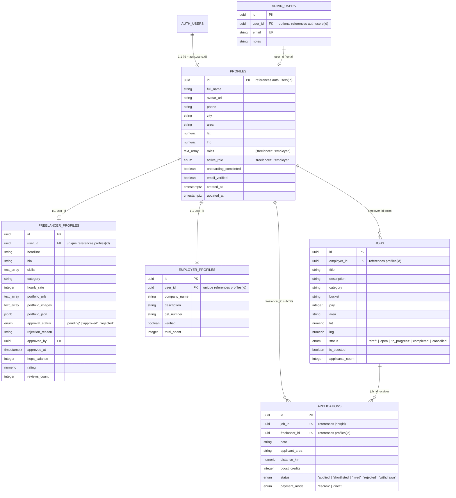

# WorkHop Database Schema & ER Diagram

## Overview
WorkHop's database architecture uses Supabase (PostgreSQL 15+) with Row Level Security (RLS) enabled on all public tables. The data model decouples core user identity from role-specific workspaces (`freelancer_profiles` and `employer_profiles`), allowing users to seamlessly hire and work from a single account without data collision.

## Storage Buckets
1. **`avatars`** (Public): User profile images and avatars. Max 3MB. Path pattern: `{auth.uid()}/avatar.{ext}`.
2. **`portfolio`** (Public): Verified work samples, photos, designs. Max 10MB. Path pattern: `{auth.uid()}/portfolio/{filename}`.
3. **`job-attachments`** (Private): NDA documents, specs, contracts. Max 15MB. Path pattern: `{auth.uid()}/jobs/{filename}`.
